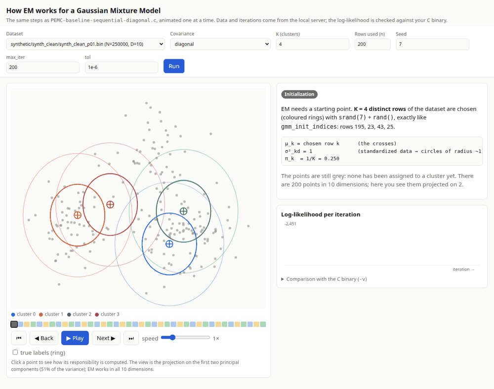

# Visualization of the algorithm

How to run the step-by-step web visualization of the EM algorithm locally. A small web page shows how EM works on any dataset of `data/`: the initial centroids, then for every iteration the E-step (points coloured by their responsibilities), the convergence test on the log-likelihood and the M-step (means and ellipses moving to their new values). It also shows the formulas with the real numbers of the current iteration, the log-likelihood curve, and the calculation of any point you click. How to run the experiments: [exec-local.md](exec-local.md) (locally) and [exec-cluster.md](exec-cluster.md) (cluster). Run everything from the root of the repository.

## Requirements

- Python 3 with NumPy
- a C compiler (`gcc`)
- at least one dataset in `data/` (see [exec-local.md](exec-local.md) for generating or downloading them)
- the browser only needs to reach `127.0.0.1`

## Run

The page is [src/visual-sequential/index.html](../src/visual-sequential/index.html), served by a small Python server ([src/visual-sequential/server.py](../src/visual-sequential/server.py)) that runs the EM and the C binary:

```bash
make                                       # builds the two sequential C binaries (diagonal and full)
python3 src/visual-sequential/server.py    # then open http://127.0.0.1:8000
```

## Usage

Choose the dataset, the covariance (**diagonal** or **full**), `K`, the number of rows (at most 3000), the seed, `max_iter` and `tol`, then press **Run**.

Controls: play/pause, back/next phase (also with the arrow keys and space), speed slider, clickable timeline, and a checkbox that draws the true labels as rings.

## How it relates to the C program

- The initial rows are chosen with the **same libc `srand()`/`rand()`** as `gmm_init_indices()` (called through `ctypes`), so the starting point is the same.
- The server repeats the same EM as `PEMC-baseline-sequential-diagonal.c` or `PEMC-baseline-sequential-full.c` (depending on the covariance chosen; same floors and convergence test) in NumPy, recording every iteration. With full covariance the ellipses are tilted, because they follow the correlations between variables.
- It also runs the **real binary** of the chosen model with `-v` on the same data and the page compares the log-likelihood of every iteration (expandable section under the chart). A mismatch would mean that the page and the C code have diverged.
- The data have D dimensions: the plot is the projection on the first two principal components (the percentage of variance kept is shown), while EM uses all dimensions.

## Example

Run on `synth_clean` (synthetic dataset with 4 true clusters, `K = 4`, `D = 10`, first 200 rows, diagonal covariance, seed 7). The 4 centroids start on 4 arbitrary points; at every iteration the E-step colours each point by how likely it belongs to each cluster, the convergence test checks whether the log-likelihood stopped growing, and the M-step moves means and ellipses to the new values. After 12 M-steps the 4 clusters are stable and the log-likelihood curve (right) is flat. Two of them (blue and green) still overlap in the picture because the plot is a 2D projection that keeps only 51% of the variance; EM separates them using all 10 dimensions.


